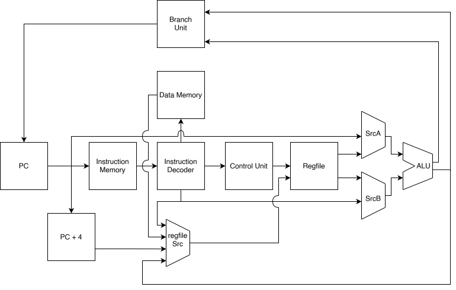

# RV32IM_SoC

- [x] RV32I minus trap, FENCE, ECALL/EBREAK 
- [ ] RV32IZicsr + trap, FENCE, ECALL/EBREAK
- [ ] RV32IZicsr + M extension
- [ ] RV32IMZicsr + 5 stage pipeline

## Verification
riscv-formal used to verify RV32I

## [x] RV32I
CPI = 1.0 in simulations

Fmax = 60 MHz on Arty A7 100T

RV32I_notrap High-Level Schematic

